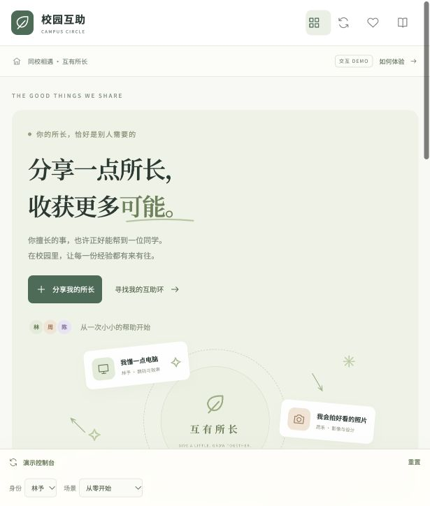

# 校园互助平台 · 产品 Demo 项目

让人们用自己能提供的帮助，获得自己需要的帮助；以同校场景作为首轮验证。

**当前阶段：已实现互助网页 Demo，并新增需求对话、可编辑需求卡和辅助匹配。DeepSeek 服务端接口已编写，真实模型待开通 API 后接通；公开交互示例明确标注为预设内容。**



## 在线体验

[打开校园互助 Demo](https://campus-help-circle.aurorakoala1.chatgpt.site) · [GitHub 仓库](https://github.com/snow49277/campus-circle-demo)

## 产品原则

- 一次双方认可的帮助，换一次获得帮助的机会；不按技能、时长或难度定价。
- 支持直接互换、多人互助环，以及跨时间保留尚未获得回报的贡献。
- 允许先获得一次帮助；尚未完成对应付出时，暂不能再次接受帮助。
- 同校身份、经历作品、互助反馈和可选沟通帮助用户判断是否适合。
- 已完成贡献不因环断裂而消失；持续关系由双方自愿继续。

## 项目文档

1. [产品定义与 Demo 范围](docs/01-产品定义与Demo范围.md)
2. [竞品与参考案例分析](docs/02-竞品与参考案例分析.md)
3. [产品需求文档 PRD](docs/03-产品需求文档PRD.md)
4. [用户流程与验收脚本](docs/04-用户流程与验收.md)
5. [Demo 实现与验证](docs/05-Demo实现与验证.md)
6. [AI 需求助手、架构与评测](docs/06-AI需求助手与辅助匹配.md)

竞品资料来自 2026-10-17 查询的官方公开页面，文档内附来源和研究限制。用户访谈尚未开展，文档中的设计人物与验证方案不是实际研究成果。

## 本地运行

需要 Node.js 22.13 或更新版本；V0.2 使用 Vinext 和 Cloudflare Worker 提供服务端 AI 接口。

```sh
cd site
npm ci
npm run dev
```

在浏览器中打开终端显示的本地地址（默认 `http://127.0.0.1:5173`）。执行 `npm test` 运行29项业务与接口测试；测试不会调用付费模型。

真实模型接入方式、变量名和费用控制边界见 AI 文档；不要向 GitHub 提交 API Key。

## 体验顺序

1. 进入“AI 需求助手”，选择预设想法，补齐条件并确认需求卡；或直接发布供需。
2. 进入“我的互助环”，发起三人环。
3. 用底部控制台切换林予、周禾、陈一，分别确认邀请。
4. 在“我的约定”中，帮助者提交完成，接受者确认。
5. 尝试底部的成员退出、持续互助和先接受后付出场景。

## 目录

```text
docs/                     产品、竞品、PRD、流程与AI评测设计
site/public/              网页和文档副本
site/public/domain.js     互助业务规则
site/public/assistant-*.js 需求卡、候选筛选和助手交互
site/lib/ai-service.mjs    DeepSeek服务端适配、校验和错误处理
site/app/api/ai/           站点AI接口
site/tests/               29项业务与接口测试
site/evals/               待执行的真实模型评测样例
```

## 实现边界

这是虚构校园的单浏览器演示。没有真实认证、实时消息、生产级匹配与远程数据存储；不收集真实学生信息。各功能的实现情况和未完成项见验证文档。PRD 描述的完整目标产品大于当前 Demo 范围。

在线网页已公开发布；源码与文档保存在本仓库。
