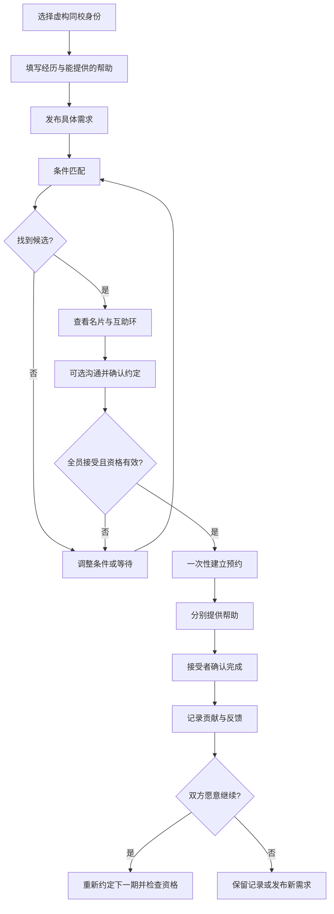
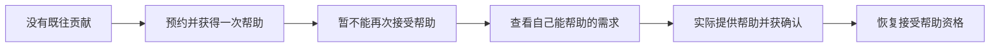

# 用户流程与 Demo 验收脚本

版本：v0.1｜日期：2026-10-17｜状态：设计与待执行脚本，不是测试通过报告

## 1. 主流程

## 2. 先接受后付出

## 3. 演示数据设计

校园使用“示例大学”，所有人物、作品和反馈均明确标为虚构。每个场景独立初始化，不把不同脚本的次数混用。

| 人物 | 能提供 | 当前需求 | 用途 |
| --- | --- | --- | --- |
| 林予 A | 电脑配置检查 | 吉他和弦转换练习 | 主操作身份 |
| 周禾 B | 摄影构图交流 | 电脑配置检查 | A 帮 B |
| 陈一 C | 吉他和弦转换练习 | 摄影构图交流 | B 帮 C、C 帮 A |
| 许宁 D | 吉他和弦转换练习 | 暂无需求，愿意保留贡献 | 退出后的单向替补 |
| 顾晓 E | 演讲练习 | 无相关可用供给的需求 | 无结果场景 |

前三位形式和可用时间相容，但同一人的两份约定不重叠。D 的资料和意愿只有在替补场景启用，不在主流程中预设自动接受。

## 4. 手工验收脚本

| ID | 场景与操作 | 预期结果 |
| --- | --- | --- |
| AC-01 | A、B、C 发布供需，运行匹配 | 展示 A→B→C→A；解释每条边的供需对应；候选不是已成立预约 |
| AC-02 | 只接受两位成员的邀请 | 环仍待确认，未建立交易预约；模拟第三位接受后才成立 |
| AC-03 | 在最终确认前改变一个需求或成员资格 | 原候选不能直接成立；展示失效原因；没有部分新增预约 |
| AC-04 | 三条边按不同顺序确认完成 | 每完成一条只更新相关两人；最终每人提供与接受各一次 |
| AC-05 | 新用户先预约一次，再尝试接受另一邀请 | 第二次被阻止；取消首个未开始预约后可以再次预约 |
| AC-06 | 新用户先获得一次帮助，再发布或接受新求助 | 发布和沟通仍可用，但新接受预约受限；实际帮助别人并确认后恢复 |
| AC-07 | 受限用户仅发布帮助或标记自己“已完成” | 未经接受者确认，不恢复资格 |
| AC-08 | 同一完成按钮重复点击、刷新后再次操作 | 只有一个完成事件；双方各只计一次 |
| AC-09 | A→B 已完成，C 退出且其余边未开始 | A 的贡献保留、B 的接受记录保留；B→C 与 C→A 取消并释放预约 |
| AC-10 | 上述退出后邀请 D→A 单向替补 | D 自愿确认后建立；不要求 A 再付出；完成后 D 保留贡献，A 已提供与接受各一次 |
| AC-11 | 找不到 D 或 D 拒绝 | 展示等待匹配，A 的贡献继续保留；不显示“修复成功” |
| AC-12 | 正在进行的约定请求取消或双方有分歧 | 不立即释放占用或改变完成次数；进入协商或争议；演示处理结果可追踪 |
| AC-13 | 首期持续帮助完成后，只有一方想继续 | 不自动创建新约定；可保留关系历史 |
| AC-14 | 接受者已有一次未抵偿帮助，邀请下一期 | 下一期不能成立；先帮助别人后可重新确认 |
| AC-15 | 提供者无当前需求，双方有资格并完成新一期 | 提供者新增一份未获回报贡献；不因“原来认识”而跳过确认 |
| AC-16 | 同类别但无共同时间、形式冲突或不同学校 | 不形成有效候选；有明确调整入口 |
| AC-17 | 未完成约定尝试评价，或尝试评价非参与约定 | 阻止提交；已完成参与者可评价一次 |
| AC-18 | 用户查看其他边的私聊、或自助交易 | 不允许；环图只展示协调所需状态 |
| AC-19 | 手机宽度、键盘、刷新和重置演示 | 主流程可操作；焦点和错误提示可见；刷新保留；重置确认后恢复初始数据 |
| AC-20 | 模拟邀请超时或接受者未确认完成 | 前者候选失效；后者提醒／争议，不自动计账 |

## 5. 核心规则的自动验证建议

实现后应针对资格、状态转移与记录唯一性编写少量有意义的测试；不为静态文案或颜色编写重复实现的测试。

- 对新用户和不同 G、H、R 组合验证资格约束。
- 两个同时到达的接受操作最多允许剩余容量内的预约成立。
- 环的最终确认任意成员失败时无部分占用。
- 重复确认不重复计数；取消不产生贡献；未授权身份不能确认他人的接受结果。
- 退出不删除完成事件，续约重新检查资格。
- 匹配不返回本人边、跨校边、重复用户或不可用的时间安排。

首版无真实服务端，因此多设备并发、真实身份和远程消息不属于可验证能力。后续接入后端后需补充事务与访问控制测试。

## 6. 用户体验观察脚本

给试用者三个任务，不提前解释所有机制：找到合适的帮助、完成三人互助、处理帮助者退出。记录卡住的位置、对“贡献记录”和“先接受一次”的解释，以及是否误认为平台保证回报。结果留空，待真实试用后填写。

